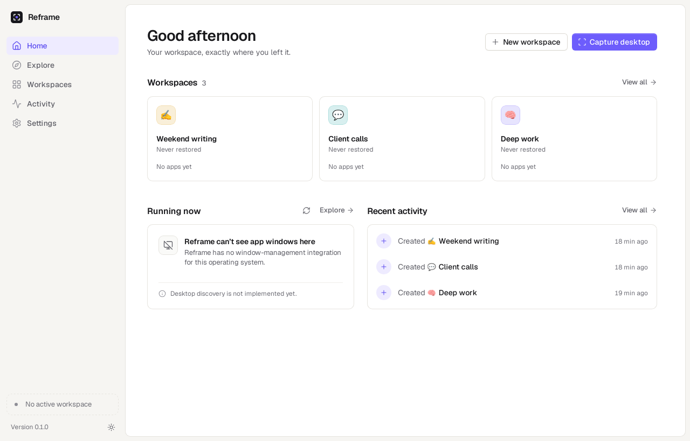
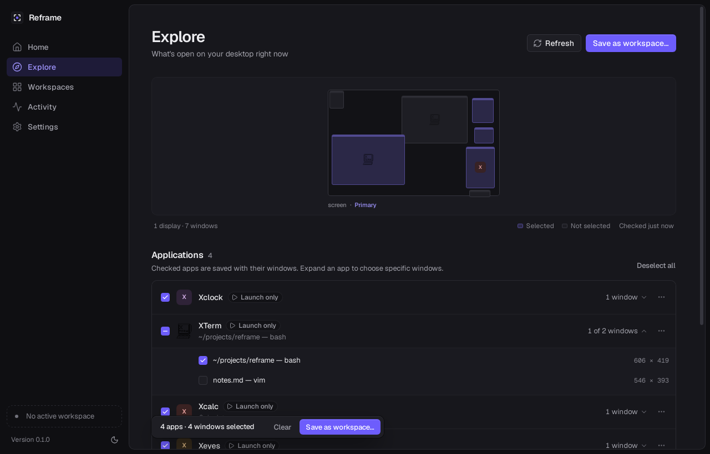
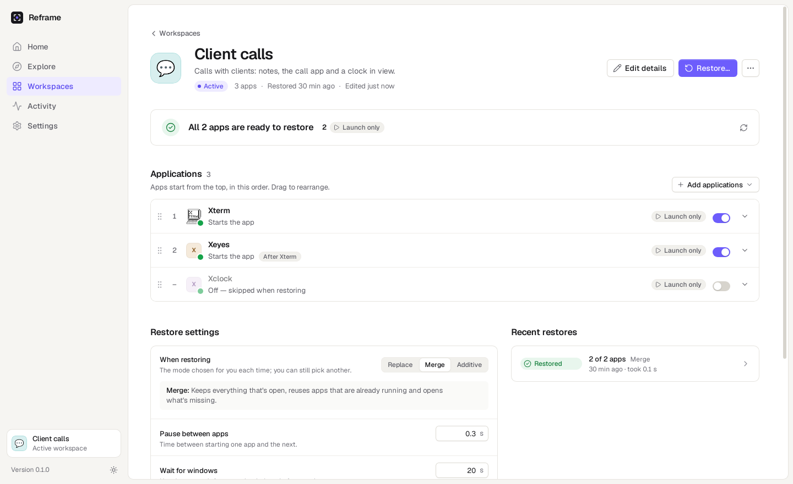
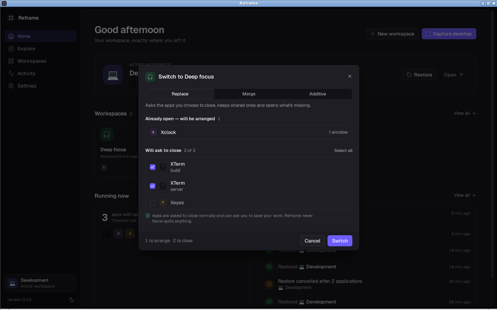

<p align="center">
  
</p>

<h1 align="center">Reframe</h1>
<p align="center"><strong>Your workspace, exactly where you left it.</strong></p>

Reframe remembers how you work. It captures your working environment — the applications you
have open, where their windows sit on your monitors, your VS Code projects, browser windows and
tabs, terminal folders, open folders and documents — as named **workspaces**, and brings them back
with one click after a restart or when you switch between projects.

**Free. Offline. No account. No telemetry.** Everything stays in a local SQLite database on your
computer.

<p align="center">
  <a href="https://github.com/bajpaisushil/reframe/releases/latest"><strong>⬇ Download Reframe for Windows, macOS or Linux</strong></a>
</p>

<p align="center">
  
  
</p>
<p align="center">
  
  
</p>

## Download & install

One link for every computer: **[github.com/bajpaisushil/reframe/releases/latest](https://github.com/bajpaisushil/reframe/releases/latest)**.
Open it, scroll to **Assets**, and download the file for your system:

| Your computer | Download | Install |
|---|---|---|
| **Windows 10 / 11** | `Reframe_<version>_x64-setup.exe` (or the `.msi`) | Run it. Because the app is not code-signed yet, Windows may show *"Windows protected your PC"* — click **More info → Run anyway**. |
| **Mac with Apple silicon** (M1 and later) | `Reframe_<version>_aarch64.dmg` | Open the `.dmg` and drag **Reframe** into **Applications**. The app is not notarized yet, so the first time right-click it → **Open** → **Open**. If macOS says the app *"is damaged"*, run `xattr -cr /Applications/Reframe.app` in Terminal and open it again. |
| **Mac with Intel** | `Reframe_<version>_x64.dmg` | Same as above. |
| **Ubuntu, Debian, Linux Mint** | `Reframe_<version>_amd64.deb` | `sudo apt install ./Reframe_*_amd64.deb` |
| **Fedora, openSUSE** | `Reframe-<version>-1.x86_64.rpm` | `sudo dnf install ./Reframe-*.x86_64.rpm` |
| **Any other Linux** | `Reframe_<version>_amd64.AppImage` | `chmod +x Reframe_*.AppImage && ./Reframe_*.AppImage` |

After installing:

- **macOS:** Reframe asks for **Accessibility** (to read and arrange windows) and **Screen
  Recording** (to read window titles) in *System Settings → Privacy & Security*. Nothing is
  recorded or sent anywhere; macOS just requires these permissions to see other apps' windows.
- **Linux:** full window management needs an X11 session. On Wayland, Reframe still relaunches
  your apps, projects, tabs and terminal folders, but cannot position windows
  ([why](docs/PLATFORM_SUPPORT.md)).
- **Start at login** is off by default — turn it on in *Settings → Startup*.

Your data lives in `reframe.db` in your user's app-data folder (Windows `%APPDATA%\app.reframe.desktop`,
macOS `~/Library/Application Support/app.reframe.desktop`, Linux `~/.local/share/app.reframe.desktop`).
Uninstalling the app does not delete it; remove that folder to start fresh.

## What it does

**Explore → Capture → Save → Restore**

- **Explore your desktop** — see the applications that have windows open (not background
  processes), what Reframe can restore for each, and pick what to include.
- **Capture & save** named workspaces with an emoji, color and description — e.g.
  *Software Development*, *Learning*, *Meetings*, *Project Alpha*.
- **Restore with one click** — applications launch in your configured order (independent apps in
  parallel), windows return to their positions and monitors, and progress is shown live. One app
  failing never blocks the others, and failed apps can be retried.
- **Switch workspaces** in three modes:
  - **Replace** — asks you which apps of the previous workspace to close (apps get a normal close
    request and can ask you to save your work; nothing is ever force-quit), keeps shared apps,
    launches what's missing.
  - **Merge** — keeps everything running, opens what's missing and arranges windows.
  - **Additive** — just adds the workspace's apps.
- **Edit workspaces** — reorder the launch sequence with drag & drop, set dependencies, delays,
  retries and timeouts, add or remove applications, configure each app.
- **Multiple monitors** — windows go back to the monitor they were on; if that monitor is gone they
  are remapped proportionally onto the displays you have now.
- **Startup restore** — optionally start Reframe at login and restore a chosen workspace (or the
  last active one), asking first if you prefer.
- **Portable workspaces** — export to JSON and import on another computer; a mapping screen helps
  when apps or folders live elsewhere. Exports never contain passwords, tokens or credentials.
- **System tray** — restore any workspace from the tray menu.

### Application integrations

| Application | What Reframe restores |
|---|---|
| Visual Studio Code (Insiders, VSCodium) | Project folders and `.code-workspace` files; VS Code restores its own editors |
| Chrome, Edge, Brave, Chromium | Browser windows and their tabs (read from the browser's local session file — optional) |
| Terminals (Windows Terminal, GNOME Terminal, Konsole, iTerm2, Terminal.app, kitty, Alacritty, …) | Windows, working directories, profiles; startup commands only if you add and approve them |
| File managers (Explorer, Finder, Nautilus, Dolphin, …) | Open folders |
| PDF readers (SumatraPDF, Acrobat, Okular, Evince, Preview, …) | Open documents, and pages where the reader exposes them |
| Music apps (Spotify, Apple Music, …) | The app, and a playlist you choose (Spotify) |
| Any other application | Launch plus window position, size and state |

Each integration reports its level honestly in the app: **Full restore**, **Partial**,
**Launch only** or **Not supported**.

## Platform support

Reframe is one codebase with native installers per OS: Windows (`.msi`/`.exe`), macOS (`.dmg`,
Apple Silicon and Intel) and Linux (`.deb`, `.rpm`, `.AppImage`). Operating systems differ in what
they allow — for example Wayland compositors do not let applications move other applications'
windows, and macOS requires Accessibility permission. See
[docs/PLATFORM_SUPPORT.md](docs/PLATFORM_SUPPORT.md) for the exact capabilities and limitations.

## Build from source

Prerequisites:

- [Node.js](https://nodejs.org) 22+ and [Rust](https://rustup.rs) 1.95+
- **Linux:** `sudo apt install libwebkit2gtk-4.1-dev libayatana-appindicator3-dev librsvg2-dev libxdo-dev libssl-dev build-essential`
- **Windows:** Microsoft C++ Build Tools; WebView2 (preinstalled on Windows 10/11)
- **macOS:** Xcode Command Line Tools

```bash
npm ci
npm run tauri dev      # run in development
npm run tauri build    # build an installer for your OS (output in src-tauri/target/release/bundle)
```

## Tests

```bash
cd src-tauri
cargo test --workspace                          # engine, adapters, storage, import/export
cargo test -p reframe-platform --features mock  # platform layer
bash crates/reframe-platform/tests/run-x11-tests.sh   # Linux: real windows under Xvfb
cd .. && scripts/e2e-x11.sh                     # Linux: capture → close → restore end to end
npm run typecheck && npm test && npm run build  # frontend
```

## Privacy & safety

- No network access, accounts, analytics or telemetry. Your data lives in the app data folder
  (`reframe.db`).
- Reframe never force-kills applications and never replays terminal history; it only runs startup
  commands you explicitly approved, and imported workspaces always arrive with those switched off.
- Imported files are validated strictly; exports are sanitized.

## Project layout

See [docs/ARCHITECTURE.md](docs/ARCHITECTURE.md). In short: React UI in `src/`, a thin Tauri
command layer in `src-tauri/src/`, the workspace engine in `src-tauri/crates/reframe-core/` and the
native OS integrations in `src-tauri/crates/reframe-platform/`.
