# Reframe user guide

**Your workspace, exactly where you left it.** Reframe remembers the apps and windows you work
with, and brings them back, arranged, in one click.

This guide walks you through everything Reframe can do, with screenshots of the real app. You
don't need any technical knowledge to follow it.

The screenshots were taken on Linux, so they show Linux apps: XTerm (a terminal), Mousepad (a
text editor), Thunar (a file manager), zathura (a PDF reader) and Xclock (a clock). On Windows
and macOS you'll see your own apps instead, and the steps are the same.

## In this guide

- [What Reframe does](#what-reframe-does)
- [Install and first launch](#install-and-first-launch)
- [Quick start](#quick-start)
- [1. Explore your desktop](#1-explore-your-desktop)
- [2. Save a workspace](#2-save-a-workspace)
- [3. Restore and switch](#3-restore-and-switch)
- [4. Your workspaces](#4-your-workspaces)
- [5. Edit a workspace](#5-edit-a-workspace)
- [6. Start at login and automatic restore](#6-start-at-login-and-automatic-restore)
- [7. The tray menu](#7-the-tray-menu)
- [8. Move a workspace to another computer](#8-move-a-workspace-to-another-computer)
- [9. Activity and history](#9-activity-and-history)
- [10. Settings](#10-settings)
- [What each app type restores](#what-each-app-type-restores)
- [Tips for great workspaces](#tips-for-great-workspaces)
- [Troubleshooting and FAQ](#troubleshooting-and-faq)
- [Privacy and safety](#privacy-and-safety)

## What Reframe does

A **workspace** is a named snapshot of the way you work on something: the apps you had open,
what was open inside them (project folders, browser tabs, terminal folders, open folders and
documents), and where each window sat on your screens. You might have one for *Project Alpha*,
one for *Reading* and one for *Meetings*.

Reframe works in four steps:

1. **Explore**: see which apps have windows open right now.
2. **Capture**: check the ones that belong to what you're working on.
3. **Save**: give them a name, an emoji and a color.
4. **Restore**: later, after a restart or when you switch projects, bring everything back. Apps
   open in your chosen order and each window goes back to its place.

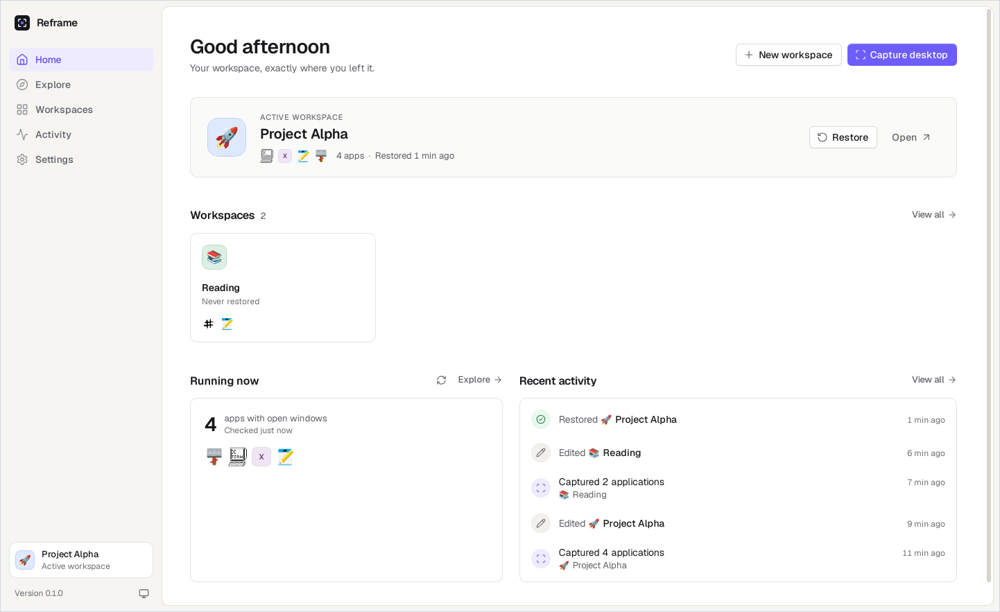

*Home shows your active workspace, your other workspaces, what's open right now and what Reframe did recently.*

Reframe is free and works completely offline. It has no account, doesn't collect any data about
you, and everything it saves stays on your computer.

## Install and first launch

Download Reframe for Windows, macOS or Linux by following
[Download & install](../README.md#download--install) in the README. It lists the right file for
your computer and what to click the first time you open it.

### Your first launch

The sidebar takes you to the five main pages: **Home**, **Explore**, **Workspaces**,
**Activity** and **Settings**. Only one copy of Reframe runs at a time: opening it again brings
the existing window to the front. Closing the Reframe window quits Reframe.

When you open Reframe for the first time, Home invites you to save your first workspace. The
**Running now** panel below it already shows how many apps have windows open.

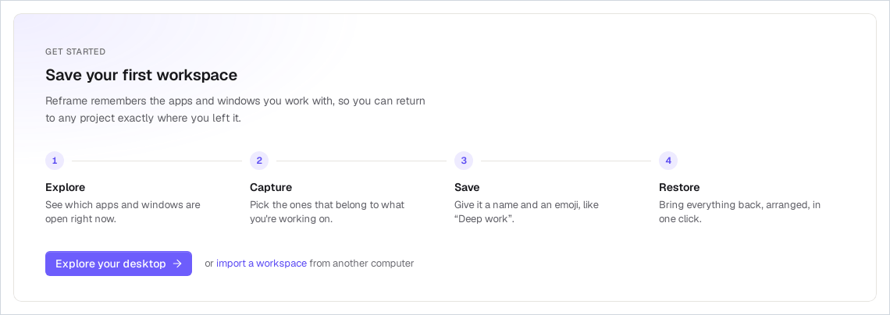

*Home on first launch.*

Click **Explore your desktop** to start, or **import a workspace** if you already exported one on
another computer.

### Permissions

What Reframe needs depends on your system:

- **macOS** needs two permissions so Reframe can see and arrange other apps' windows:
  **Accessibility** (to read, move and close windows) and **Screen Recording** (to read window
  titles). Nothing is recorded or sent anywhere: macOS requires them before any app can see
  other apps' windows.
  1. On the **Explore** page, click **Grant access** on the note *Reframe needs Accessibility
     access* (or click **Grant** in **Settings → Permissions**). The note also lists these steps
     for your version of macOS.
  2. In *System Settings → Privacy & Security → Accessibility*, switch **Reframe** on.
  3. Do the same for **Screen Recording** (called *Screen & System Audio Recording* on macOS 15
     and later), then quit and reopen Reframe.

  Saving what's open in Finder, Preview or Skim, and restoring Terminal or iTerm2 sessions that
  use a profile or an approved startup command, also needs the **Automation** permission. macOS
  asks once for each of those apps.
- **Windows** needs no special permission. One exception: apps you run *as administrator*
  can't be moved or closed by Reframe unless Reframe also runs as administrator. Reframe tells
  you when that happens.
- **Linux** works best in an **X11** session. In a **Wayland** session, the system doesn't let
  any app see or arrange other apps' native Wayland windows. If the session runs XWayland (most
  GNOME and KDE sessions do), Reframe lists and arranges only the apps that run through
  XWayland. Without XWayland it can't list or position any window. Either way, it can still
  start your apps and reopen the projects, tabs and terminal folders saved in a workspace. Many
  login screens let you pick an X11 session (often called *Xorg*) from a gear or session menu.
  **Settings → This computer** shows which session you're in.

## Quick start

1. Open the apps and files you use for one project and arrange their windows the way you like.
2. In Reframe, click **Explore your desktop** on Home (or **Explore** in the sidebar). On a Mac,
   allow the two [permissions](#permissions) first.
3. Keep the apps that belong to the project checked and uncheck the rest.
4. Click **Save as workspace…**, type a name such as *Project Alpha* and click
   **Save workspace**.
5. Later, after a restart for example, click **Workspaces** in the sidebar and click **Restore**
   on the workspace's card. Reframe opens what's missing and puts every window back. It never
   closes anything.

That's all you need. The rest of this guide explains each step and everything else Reframe can
do.

## 1. Explore your desktop

Explore shows what's open on your desktop right now, and it's where you choose what goes into a
workspace.

1. Click **Explore** in the sidebar. You can also click **Capture desktop** on Home.
2. Reframe checks which apps have windows open and lists them. Programs running in the
   background without a window aren't listed; a note at the bottom says how many there are.

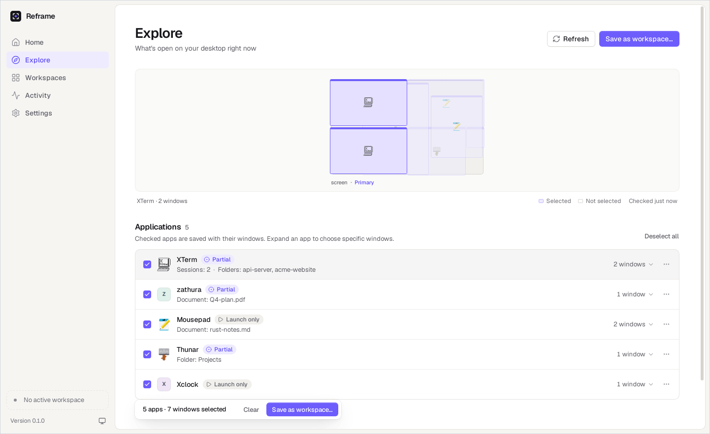

*Explore: a miniature of your screen at the top and the apps with open windows below. Hovering an app highlights its windows on the map.*

### The screen map

The map at the top is a miniature of your displays with every window drawn on it. Windows of
selected apps are tinted. Hover an app in the list to highlight its windows on the map, or click
a window on the map to include or leave out its app. The caption underneath counts displays and
windows and says when Reframe last checked.

### The app list

Apps are grouped so the important ones come first:

- **Applications**: the apps you work with. These start out checked.
- **Utilities**: small helpers, prompts and tool windows. This group starts collapsed and
  nothing in it is checked, but you can include anything.
- **System**: parts of your desktop itself, like panels and launchers. Turn on
  **Show system items** to see them. They're rarely worth saving.

Each row shows the app's name, how well Reframe can restore it (see
[What the restore badges mean](#what-the-restore-badges-mean)), what Reframe found inside it
(for example *Folders: api-server, acme-website* or *Document: Q4-plan.pdf*) and how many
windows it has. Use **Select all** or **Deselect all** to change all the applications at once,
and **Refresh** to look again after you open or close something.

### Choosing specific windows

Click the window count on the right of a row (for example **2 windows**) to see each window. If
an app has several windows, you can uncheck the ones you don't want. The app's checkbox then shows
a dash and the count reads *1 of 2 windows*.

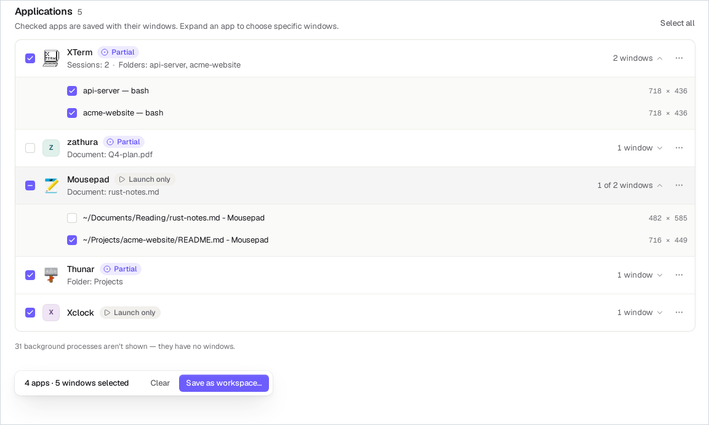

*XTerm is expanded to show both terminal windows. For Mousepad only the README window is checked, so it shows "1 of 2 windows".*

### What the restore badges mean

Every app carries a badge that says honestly how much of it Reframe can bring back on this
computer:

| Badge | What it means |
|---|---|
| **Full restore** | Reframe reopens the app with what was inside it (projects, tabs or documents) and puts its windows back. |
| **Partial** | Reframe reopens the app and some of what was inside it. A few details may need a quick touch-up. |
| **Launch only** | Reframe starts the app (with the documents it was opened with, if any) and arranges its windows, but can't reopen anything else that was inside it. |
| **Not supported** | Reframe has no way to restore this app on this system. |

If an app's program is missing, the app keeps its badge and its row on the workspace page says
*Can't be started here*. See
[An app "can't be started on this computer"](#an-app-cant-be-started-on-this-computer).

Hover a badge to see exactly what's covered. A ✓ marks what Reframe restores and a – marks what
it doesn't.

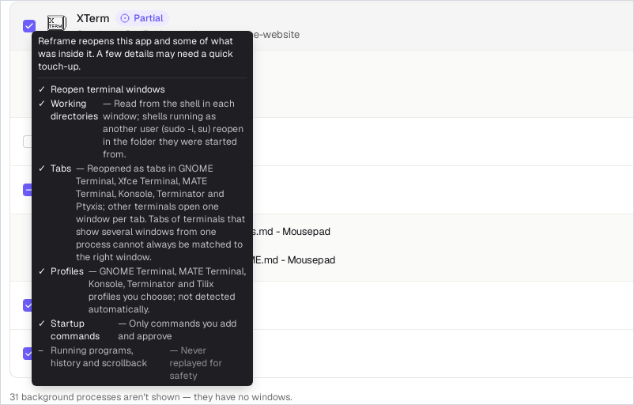

*For terminals, Reframe reopens the windows in the right folders. Running programs, history and scrollback are never replayed.*

### Never suggest an app

If there's an app you never want to save, such as a chat app, click **⋯** at the end of its
row and choose **Always exclude**. It stays in the list, unchecked, with an **Excluded** badge. To
save it this once, click **Include**. To undo, choose **Stop excluding** from the same menu. You
can review the whole list in **Settings → Excluded apps**.

> [!NOTE]
> Reframe only sees windows on the virtual desktop (Windows) or Space (macOS) you're using right
> now. On macOS, apps you've hidden with ⌘H aren't listed. If Reframe can't see windows at all
> (for example under Wayland without XWayland), Explore says *Reframe can't see app windows
> here*. You can still build a workspace by hand, as described in
> [I use Linux with Wayland](#i-use-linux-with-wayland).

## 2. Save a workspace

1. In Explore, check the apps and windows that belong together. The bar at the bottom shows what
   you've picked, for example *4 apps · 5 windows selected*.
2. Click **Save as workspace…**.
3. Type a **Name**, for example *Project Alpha*.
4. Click the icon next to the name and pick an emoji. To use one that isn't in the grid, type or
   paste it under **Any other emoji** and click **Use**.
5. Pick a **Color** if you like.
6. Add a **Description** if you like, so you remember what the workspace is for.
7. Click **Save workspace**.

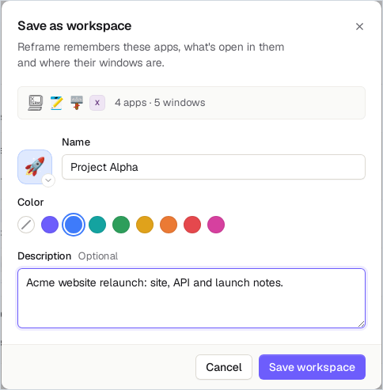

*Name, emoji, color and an optional description. The strip at the top shows what will be saved.*

For every app, Reframe saves:

- the program, so it can start it again;
- what's open inside it, as far as the app allows: project folders, browser tabs, terminal
  working folders, open folders or documents;
- each window's size, position, state (normal, maximized, minimized or full screen) and which
  display it was on.

**Adding to a workspace you already have:** once you have workspaces, the dialog offers
**New workspace** and **Add to existing**. Choose **Add to existing**, pick the workspace and click
**Add to workspace**. The apps are added after the ones already in it.

**If something didn't come through:** sometimes Reframe can't read everything, for example
where an app's program lives. The workspace is still saved, and the dialog lists what needs your
attention under *Saved, with a few notes* (or *Added to …, with a few notes*). Click
**Open workspace** to fix it (see
[An app "can't be started on this computer"](#an-app-cant-be-started-on-this-computer)), or
**Stay here** to keep exploring.

### Your new workspace

After saving, Reframe opens the workspace page:

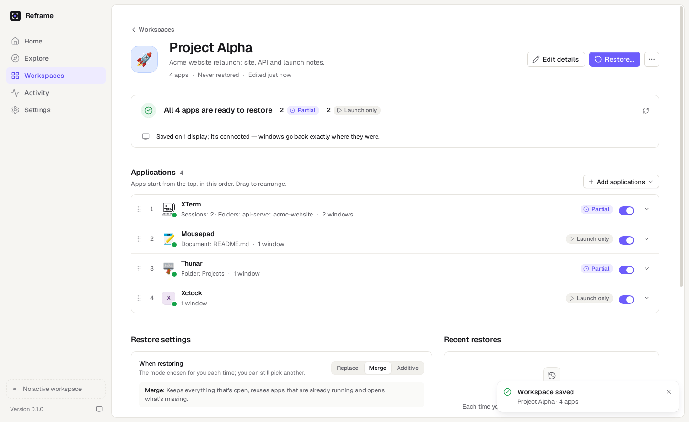

*The workspace page: a readiness summary at the top, the apps in launch order, and how this workspace restores.*

- **The readiness summary** answers "will this restore well here?", for example
  *All 4 apps are ready to restore*, and says where windows will go on the displays you have
  now. If something needs attention, it's listed here with a way to fix it.
- **Applications** is the launch sequence. Apps start from the top, in this order. A green dot on
  an app's icon means it's open right now.
- **Restore settings** and **Recent restores** are covered in
  [section 5](#restore-settings-for-this-workspace) and [section 9](#9-activity-and-history).

**Starting from scratch:** you can also create an empty workspace with **New workspace** on Home
or on the Workspaces page. Give it a name and click **Create workspace**. The empty workspace
shows two buttons: **Add from open windows** (apps that are open now) and **Choose an app…** (an
app that isn't open). Once it has apps, the same two choices are in the **Add applications** menu
(see [Add and remove apps](#add-and-remove-apps)).

## 3. Restore and switch

There are two ways to restore. **Restore** on a workspace card or on Home restores straight away
and never closes anything. **Restore…** on a workspace page (or **Restore with options…** in a
card's **⋯** menu) first shows what will happen and lets you choose how.

### One-click restore

The **Restore** button on a workspace card (Workspaces page), on the active workspace at the top
of Home, and on Home's workspace tiles (point at a tile to show it) restores straight away,
using **Default way to restore** from Settings (Merge unless you change it; see
[Three ways to restore](#three-ways-to-restore)). One-click restores never close anything:
closing only happens after you confirm it in the restore dialog. If a restore of that workspace
is already running, the button reads **View** (**View restore** on Home's active-workspace
card) and takes you to its progress.

### Three ways to restore

| Mode | What happens | Use it when |
|---|---|---|
| **Replace** | Asks apps from the workspace you're leaving to close (you choose which), keeps apps both workspaces use, and opens what's missing. | You're switching from one project to another and want a tidy desk. |
| **Merge** | Keeps everything that's open, reuses apps that are already running, opens what's missing and arranges the windows. Never closes anything. | Coming back after a restart, or topping up what you have. This is the default. |
| **Additive** | Opens every app in the workspace again as new windows, without closing or reusing anything. | You want a second copy, or an app is open with something else that you want to keep. |

### Restore a workspace, step by step

Say you restarted your computer and only one of Project Alpha's windows is open, in the wrong
place:

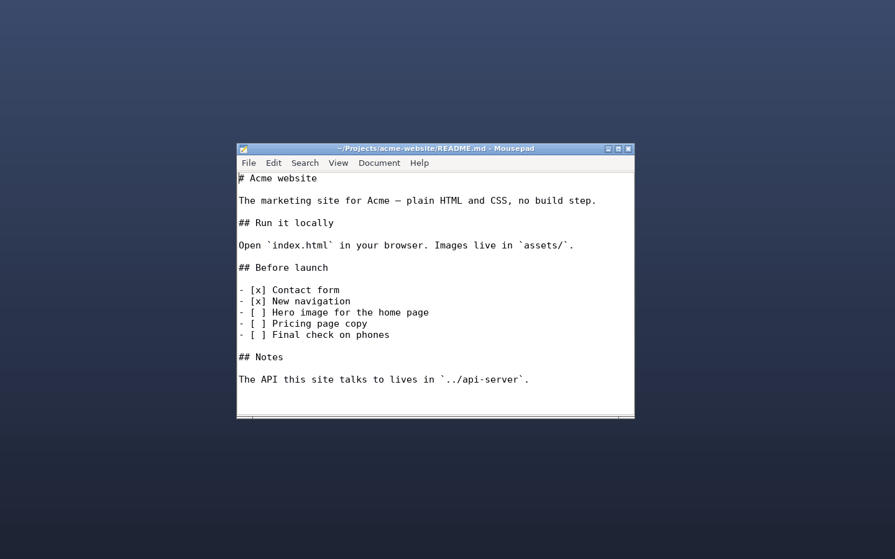

*Before: one editor window in the middle of the screen, everything else closed.*

1. Open the workspace and click **Restore…**.
2. Choose how to restore at the top: **Replace**, **Merge** or **Additive**.
3. Check the plan. **Will open** lists apps Reframe will start (with the reason, such as
   *Not running*). **Already open — will be arranged** lists apps it will reuse and move into
   place. The line at the bottom sums it up, for example *3 to open · 1 to arrange*.
4. Click **Restore**. When another workspace is active, the dialog is titled *Switch to …* and
   the button is **Switch**.

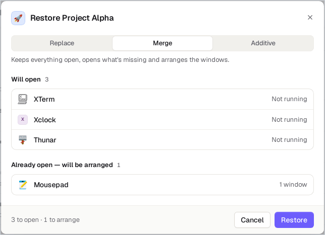

*Merge opens the three missing apps and moves the editor that's already open back into place.*

Reframe then shows the restore as it happens:

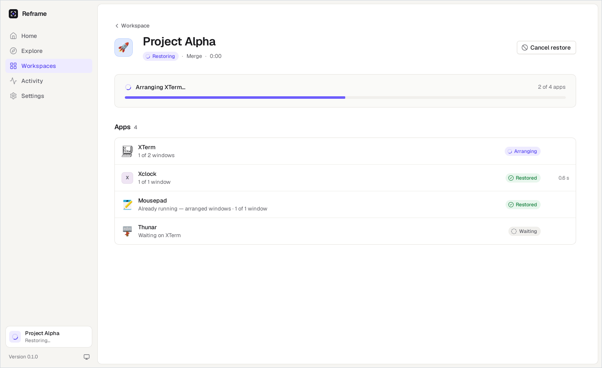

*Live progress. Thunar waits for XTerm because it was set to start after it (see [Order & timing](#order--timing-start-after-and-waiting)).*

Here's what happens, in order:

1. In **Replace**, Reframe first asks the apps you chose to close (see below).
2. It checks that each app can start here. An app that can't (for example, its program is
   missing) is marked **Failed** with the reason, and apps set to start after it are
   **Skipped**.
3. It starts the apps in your order. Apps that don't depend on each other start in parallel, and
   apps set to start after another one wait (*Waiting on XTerm*).
4. As each app's windows appear, Reframe moves them back to their saved size, position and
   state. If a display has changed size, windows are moved and scaled to fit. If a display you
   used is no longer connected, its windows go to your main display.
5. Each app gets a status: **Waiting**, **Checking**, **Launching**, **Arranging**, then
   **Restored**, **Partly restored**, **Failed** or **Skipped**.

One app failing never stops the others. Only the apps set to start after it are skipped.

When everything is done, you get a summary:

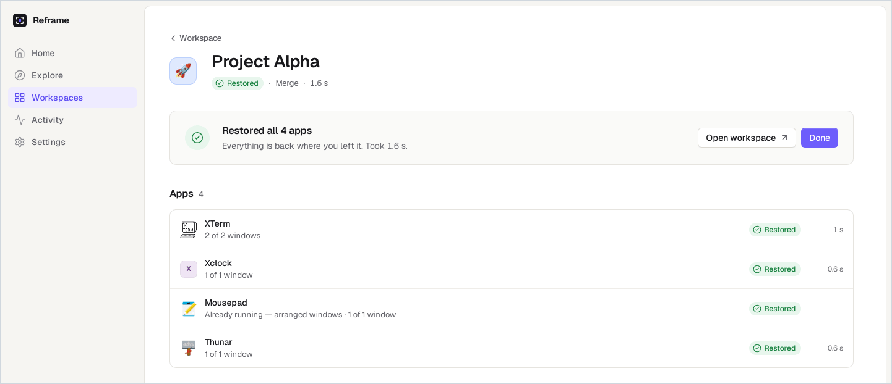

*The summary says how it went and how long it took.*

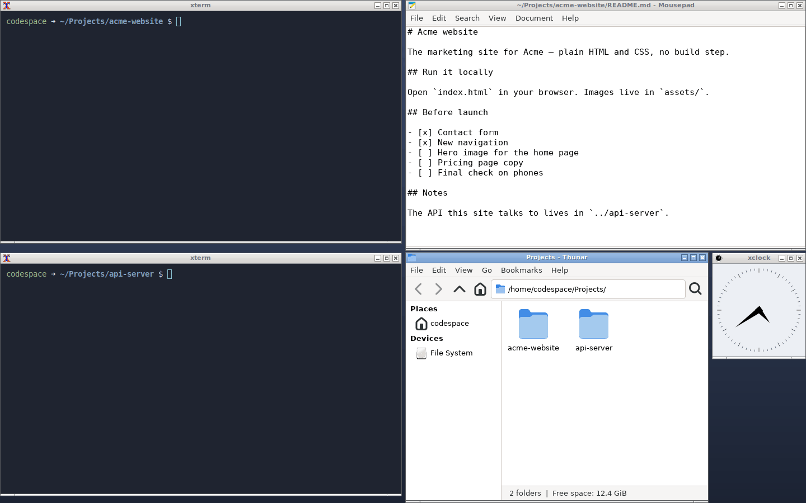

*After: every window is back in its saved place, and the terminals are in their project folders.*

### Switch workspaces with Replace

When you move from one project to another, **Replace** clears the old project's apps away:

1. Open the workspace you want to switch to and click **Restore…**, or choose
   **Restore with options…** from the **⋯** menu on its card.
2. Choose **Replace**.
3. Under **Will ask to close**, apps that belonged only to your previous workspace are checked.
   Uncheck anything you'd like to keep. Other open apps are listed unchecked; check them if you
   want them closed too.
4. Click **Switch**.

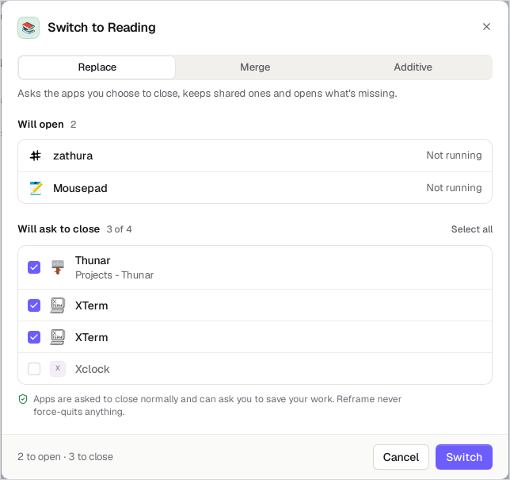

*Thunar, both terminals and Xclock were only in Project Alpha, so they start out checked. Xclock was unchecked here to keep it open.*

Closing is always a polite request, just like clicking an app's close button. An app with
unsaved work can ask you to save, and Reframe waits for it. **Reframe never force-quits
anything.** The restore page has a **Closing apps** section that shows how each one went:
**Asking to close**, **Closed**, **Still open** (*Waiting for you — it may be asking to save
changes*) or **Couldn't close**. How long Reframe waits is set by **Wait for apps to close** in
Settings.

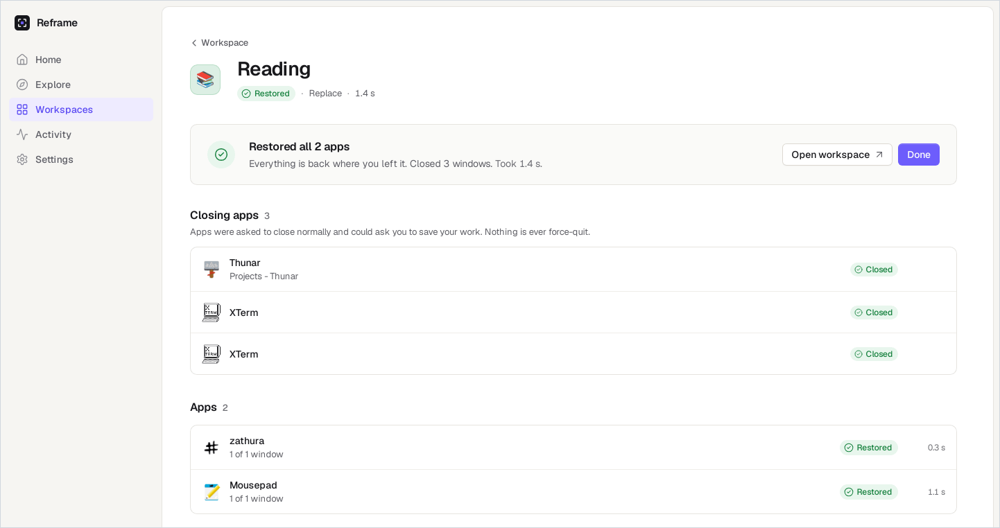

*The switch closed three windows and opened the PDF and the notes.*

### Cancel, retry and what the results mean

- **Cancel restore** (top right while a restore runs) stops Reframe from starting more apps.
  Apps that already opened stay open. Click **Restore the rest** afterwards to finish the job.
- **Retry failed** starts again only the apps that failed, came back partly, or were skipped
  because of them. If no app failed but some came back only partly, the button reads
  **Try again**.
- **Partly restored** means the app opened but not everything came back, for example one of
  two windows. The detail line under the app says what happened.
- **Launch only** apps are started with their documents and their windows arranged; anything
  else inside them is up to the app itself.
- **Interrupted**: if Reframe was closed in the middle of a restore, the report says
  *This restore was interrupted*. Apps that opened are still open, and **Restore again** starts
  over with the same mode.
- Notes from the restore appear under **Good to know**. If a restore couldn't run at all, the
  reason appears under **Why this restore stopped**.

## 4. Your workspaces

Click **Workspaces** in the sidebar to see everything you've saved.

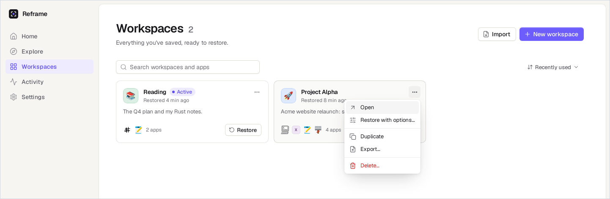

*Each card shows the workspace's apps and when it was last restored. The **⋯** menu holds the other actions.*

- **Open a workspace** by clicking its card.
- **Restore it in one click** with the card's **Restore** button.
- The **Active** badge marks the workspace you restored most recently. It's also shown at the
  bottom of the sidebar; click it to jump to that workspace.
- **Search** with the box at the top (or press Ctrl+F, ⌘F on a Mac). It matches workspace names,
  descriptions and the names of the first eight apps in each workspace, so typing *mousepad*
  finds the workspaces that have Mousepad among their first eight apps.
- **Sort** by **Recently used**, **Name** or **Recently created**.

The **⋯** menu on each card has:

- **Open**: shows the workspace page.
- **Restore with options…**: lets you choose how to restore (see [section 3](#3-restore-and-switch)).
- **Duplicate**: saves a copy named like *Project Alpha (copy)*. Handy for variations.
- **Export…**: saves the workspace to a file (see [section 8](#8-move-a-workspace-to-another-computer)).
- **Delete…**: removes the workspace and its restore history from Reframe. Your apps, files and
  open windows aren't affected.

Home shows the same workspaces in a compact form: your active workspace with **Restore** and
**Open**, up to six recently used workspaces as tiles (point at a tile to show its **Restore**
button), **Running now** and **Recent activity**.

## 5. Edit a workspace

Open a workspace to change anything about it. Your edits are a draft until you save them: a bar
appears at the bottom with **Unsaved changes**, **Discard** and **Save changes**. You can also
press Ctrl+S (⌘S on a Mac). If you try to leave with unsaved changes, Reframe asks whether to
**Discard changes**, **Keep editing** or **Save and leave**.

### Name, emoji and color

Click **Edit details** at the top to change the name, emoji, color or description, then click
**Save**. These also appear in the tray menu.

### Add and remove apps

Click **Add applications** above the app list:

- **From open windows…** shows the apps that are open now. Check what you want (expand an app to
  pick specific windows) and click **Add**. If the app isn't in the list, click
  **Choose an app manually…** at the bottom of the picker.
- **Choose an app…** lets you pick a program file (or an app in the Applications folder on a
  Mac) for an app that isn't open right now. Reframe only starts an app added this way: it has
  no saved content (projects, tabs, folders or documents) and no window positions.

In a workspace that has no apps yet, the same two choices are buttons in the middle of the page:
**Add from open windows** and **Choose an app…**.

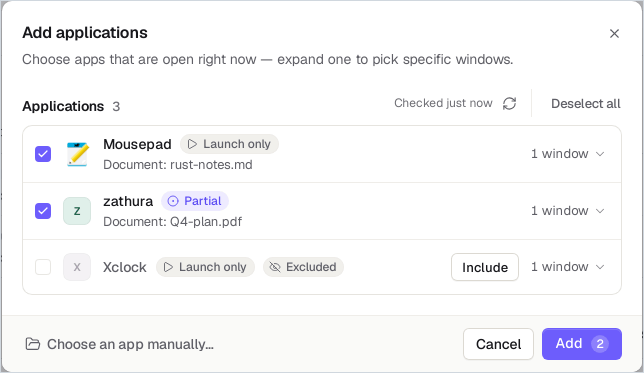

*The picker works like Explore. Excluded apps stay unchecked until you click **Include**.*

New apps appear at the bottom of the list, highlighted for a moment. Click **Save changes** to
keep them.

To remove an app, click it to open its settings, click **Remove from workspace** at the bottom,
then **Remove app**. The app itself isn't affected. Only its saved content and window positions
leave the workspace.

To start over from what's open now, click **⋯** at the top of the workspace page and choose
**Update from current desktop**. Pick the apps and click **Update workspace**. This replaces the
workspace's apps with your new selection.

### Change the launch order

Apps start from the top of the list. Apps that don't wait for each other can start at the same
time (up to **Apps started at once**; see
[Restore settings for this workspace](#restore-settings-for-this-workspace)). To change the
order, drag an app by the handle (⠿) at the left of its row.

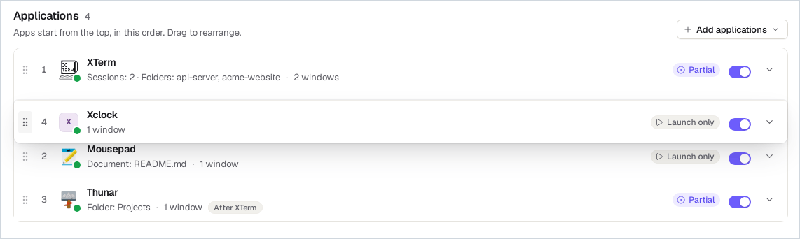

*Drag the handle to change when an app starts. The numbers update when you drop it.*

Using the keyboard: move to the handle with Tab, press Space or Enter to pick the app up, use the
arrow keys to move it, then press Space or Enter to drop it. Esc cancels.

### Turn an app off without removing it

Use the switch on the right of a row. The app stays in the workspace, marked
*Off — skipped when restoring*, and you can turn it back on whenever you like.

### Per-app settings

Click an app (or the **⌄** on its right) to open its settings. They're split into tabs:

- a first tab named after what the app reopens: **Projects**, **Tabs**, **Sessions**,
  **Folders**, **Documents** or **Playlist** (apps with nothing saved inside them don't have
  this tab);
- **Launch**: how the app is started;
- **Order & timing**: what it waits for and how long;
- **Windows**: the window positions Reframe puts back.

Changes apply the next time you restore the workspace. **Remove from workspace** at the bottom
removes the app (see [Add and remove apps](#add-and-remove-apps)).

#### Terminals: working folders and startup commands

Each terminal window or tab is saved as a **Session**. Reframe reopens each session in its
**Working folder**. You can change the folder with **Choose…**, or clear it with **×** to use your
home folder. Some terminals also let you pick a **Profile** (their saved colors and fonts).

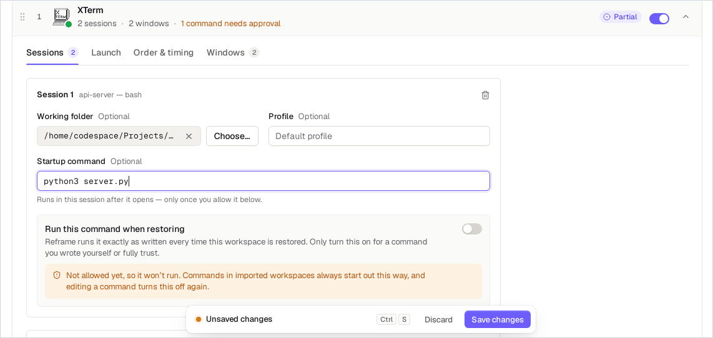

*A startup command only runs after you switch on **Run this command when restoring**. Until then, Reframe shows a reminder.*

You can also give a session a **Startup command**, for example `python3 server.py`, to run in
that terminal after it opens. (A command doesn't run if its working folder no longer exists, and
a few terminals can't run startup commands at all; see
[What each app type restores](#what-each-app-type-restores).) For your safety, a command only
runs after you allow it:

1. Type the command in **Startup command**.
2. Read the note, then turn on **Run this command when restoring**.
3. Click **Save changes**.

> [!IMPORTANT]
> **Why the extra step?** Reframe runs the command exactly as written every time you restore the
> workspace, so only allow a command you wrote yourself or fully trust. Reframe never records or
> replays the commands you typed in the past. It only runs what you put here. Changing a command
> switches it off again, and commands in imported workspaces always arrive switched off. Until a
> command is allowed, the app's row says *1 command needs approval*.

**Add session** adds another terminal window, and the bin icon removes one.

#### Folders

File managers such as Explorer, Finder or Thunar reopen a window for each folder in the
**Folders** tab. Use **Add folder…** to add one, or **×** to remove it. A folder that no longer
exists is marked **Not found**.

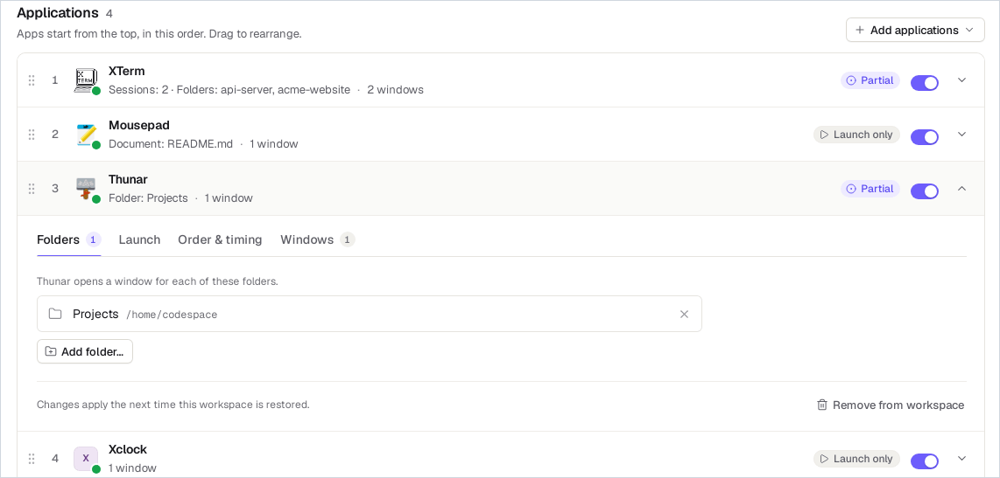

*Thunar opens a window for each folder in the list.*

#### Documents

Apps that open files, such as PDF readers and text editors, list them in the **Documents** tab.
Use **Add documents…** to add files. For readers that support it, type a **Page** to open the
document at that page.

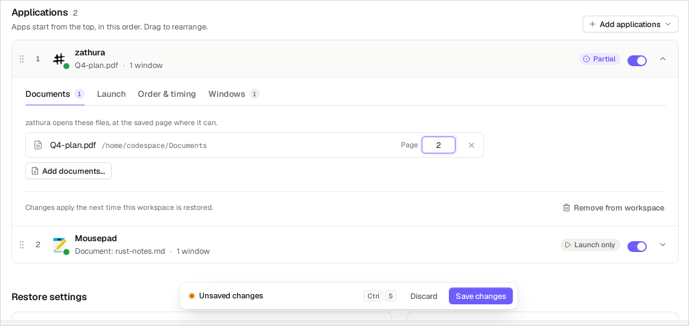

*Here the Q4 plan opens at page 2 next time.*

#### Playlist (Spotify)

In the **Playlist** tab, paste a playlist, album or track link from Spotify's **Share** menu into
**Playlist, album or station**. If you like, give it a **Name** to show in Reframe. Reframe opens
it when it starts Spotify (you may need to click play).

#### Projects and browser tabs

- **Projects** (VS Code, VS Code Insiders and VSCodium): the folders and `.code-workspace` files
  to reopen, each in its own window. Use **Add folder…** to add one. The editor restores its own
  open files, terminals and unsaved changes. Other editors, such as Cursor, are *Launch only*.
- **Tabs** (Chrome, Edge, Brave and Chromium): every saved tab, grouped by window. Remove a tab
  with **×**, or type an address such as *example.com/docs* and click **Add tab**.

#### Launch

The **Launch** tab shows the **Program** Reframe starts (use **Change…** to pick another),
**Extra arguments** passed to the app exactly as written (**Add argument**), and the
**Working folder** the app starts in. Most people never need to touch this tab.

#### Order & timing: "start after" and waiting

Sometimes one app should only start once another is ready. For example, your editor might need
the terminal that starts your project first.

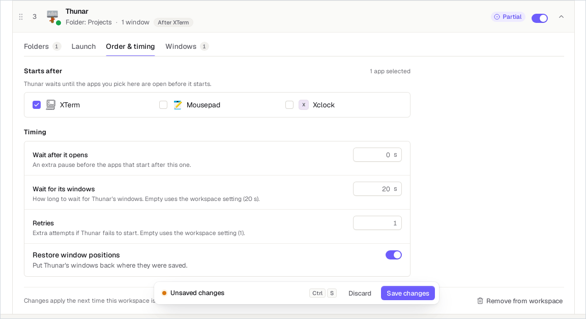

*Thunar now waits for XTerm. Its row shows an "After XTerm" label.*

- **Starts after**: check the apps this one should wait for. Its row then shows a label such as
  *After XTerm*. Reframe won't let you create a loop where apps wait for each other.
- **Wait after it opens**: an extra pause before the apps that wait for this one start.
- **Wait for its windows**: how long Reframe waits for this app's windows. Leave it empty to use
  the workspace setting.
- **Retries**: extra attempts if the app fails to start. Leave it empty to use the workspace
  setting.
- **Restore window positions**: switch this off if you'd rather this app place its own windows.

#### Windows

The **Windows** tab lists each saved window with its size, display and state. Reframe moves each
window back to this size and place. Clicking **×** only forgets that window's position; it
doesn't close anything.

### Restore settings for this workspace

Scroll down on the workspace page to fine-tune how this workspace restores:

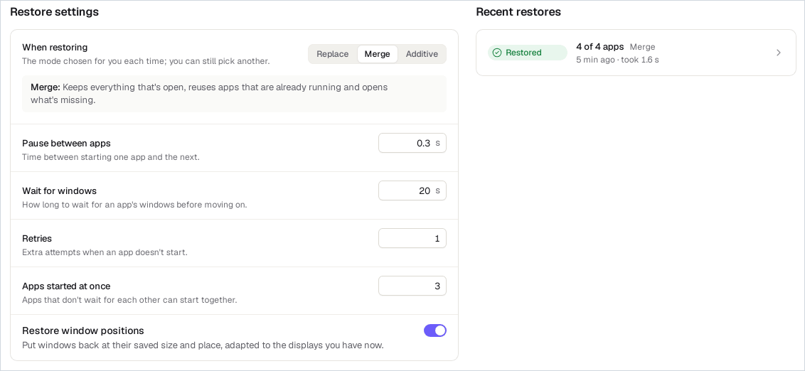

*Restore settings, and the last restores of this workspace on the right.*

| Setting | What it does | Default |
|---|---|---|
| **When restoring** | The mode chosen for you when you click **Restore…** on this page: **Replace**, **Merge** or **Additive**. You can still pick another each time. | Merge |
| **Pause between apps** | Time between starting one app and the next. | 0.3 s |
| **Wait for windows** | How long to wait for an app's windows before moving on. | 20 s |
| **Retries** | Extra attempts when an app doesn't start. | 1 |
| **Apps started at once** | Apps that don't wait for each other can start together. | 3 |
| **Restore window positions** | Put windows back at their saved size and place, adapted to the displays you have now. | On |

**Recent restores** lists the last five restores of this workspace. Click one to see its full
report.

## 6. Start at login and automatic restore

Reframe can open when you sign in to your computer and bring back a workspace for you. This is
off until you turn it on.

1. Go to **Settings** and find **Startup**.
2. Turn on **Open Reframe when you log in**.
3. Under **When Reframe opens at login**, choose **Don't restore anything**,
   **Restore a workspace** (then pick one from the list) or
   **Restore the last active workspace** (whichever you restored most recently).
4. Leave **Ask before restoring** on if you want Reframe to ask each time, or turn it off to
   restore automatically.

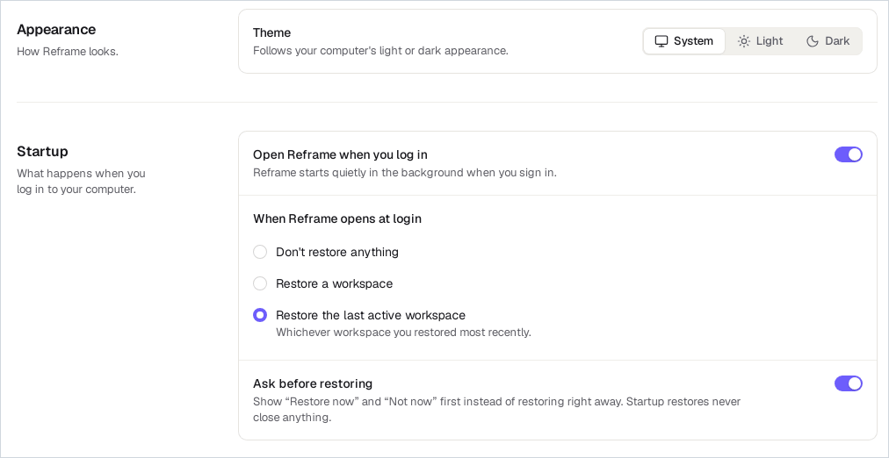

*Startup settings: open at login, restore the workspace you used last, and ask first.*

The next time you sign in, Reframe opens its window by itself. With **Ask before restoring** on,
it shows this:

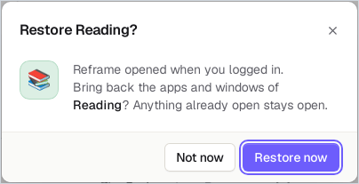

*Click **Restore now**, or **Not now** to skip it this time.*

With it off, Reframe gives your desktop a few seconds to settle, then starts restoring and
shows the progress. Startup restores always use **Merge**, so they never close anything.

## 7. The tray menu

While Reframe is open, its icon sits in the system tray (the notification area on Windows, the
menu bar on macOS). On Windows and macOS, clicking the icon brings Reframe's window to the
front. Its menu has:

- **Open Reframe**: shows the window.
- **Restore workspace** ▸ lists your workspaces (up to 15) with their emoji. The active one has
  a ✓. Choosing one restores it with **Merge**, which never closes anything, and shows the
  progress.
- **Capture desktop…** opens Explore.
- **Quit Reframe** closes Reframe.

The menu uses the names and emoji you set with **Edit details**. Closing Reframe's window quits
Reframe, tray icon included, so minimize the window instead if you want the menu at hand.

On Linux, the tray icon needs a desktop with a system tray. GNOME, for example, needs the
AppIndicator extension. Without a tray, everything else works the same.

## 8. Move a workspace to another computer

You can export a workspace to a file and import it on another computer, even one with a
different operating system.

### Export

1. On the Workspaces page, click **⋯** on the workspace's card and choose **Export…**. On a
   workspace page, it's in the **⋯** menu at the top.
2. Choose where to save the file. It's named after the workspace, for example
   *Project Alpha.reframe.json*.
3. Reframe confirms with *Exported Project Alpha* and the file's location.

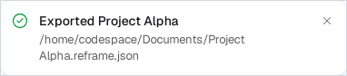

*The confirmation appears in the bottom-right corner and shows where the file was saved.*

If you have unsaved changes, Reframe first asks *Save your changes first?*. Click
**Save and continue** to export the up-to-date version.

**What's in the file:** the workspace's name, emoji, color and description, its apps and their
order, what they reopen (folders, tabs, documents and so on), window positions and restore
settings. It also notes where each app's program was installed, kept separately, so the other
computer can find its own copy.

**What's never exported:** Reframe removes passwords, user names and tokens from web addresses,
and leaves out links that are secret in themselves, such as password-reset or invitation links.
It also drops secret-looking options from launch arguments, and replaces secrets in terminal
startup commands with `<redacted>`. Data from app integrations that Reframe can't check is left
out entirely. This detection is automatic. If you typed a secret into a startup command or a
link in an unusual form, open the file and check it before you share it.

### Import

Copy the exported file to the other computer any way you like: a USB stick, email, or a shared
or cloud folder. Then, on that computer:

1. On the Workspaces page, click **Import**.
2. Click **Choose file…** and pick the file you exported (its name ends in `.reframe.json`).

   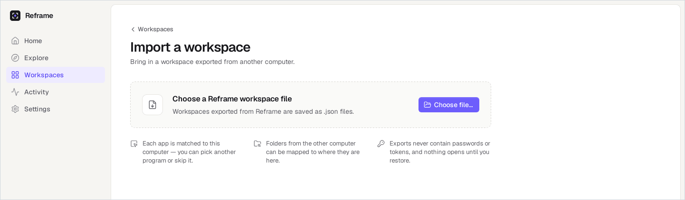

   *Click **Choose file…** and pick the exported file.*

3. Check the review page. Reframe shows where the workspace came from and matches each app to
   this computer:
   - **Exported**: found in the same place as on the other computer.
   - **Found**: Reframe found the app somewhere else on this computer.
   - **Unresolved**: Reframe couldn't find the app. Click **Choose…** to pick its program, or
     **Skip** to leave it out.
   - **Chosen** and **Skipped** show your own choices. **Include** brings a skipped app back.
4. If your folders live somewhere else on this computer, click **Add mapping** under
   **Folders**. Type the folder as it was **On the other computer** and where it is
   **On this computer**. Every path that starts with that folder is updated, and the missing
   items turn into **Mapped**.
5. Optionally change the **Name**, then click **Import workspace**.

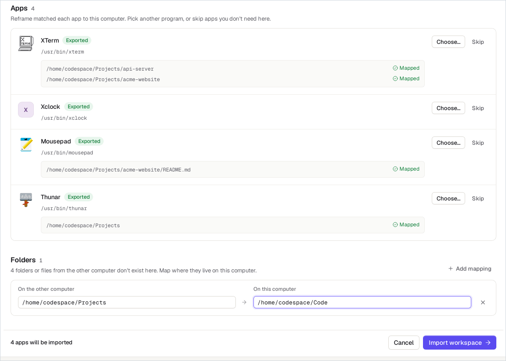

*The project folders live in a different place on this computer, so one mapping fixes all four paths.*

The imported workspace is added next to your others. It never replaces an existing one. Nothing
opens until you restore it. Imported files are checked strictly, so a damaged or tampered file
is refused with an explanation (*This file can't be imported*). For your safety, imported
terminal startup commands always arrive switched off, and custom launch arguments are removed.
Review them before you allow them again. Network locations in an imported workspace (such as
`\\server\share`) are never contacted automatically.

## 9. Activity and history

Click **Activity** in the sidebar to see what Reframe has done, newest first.

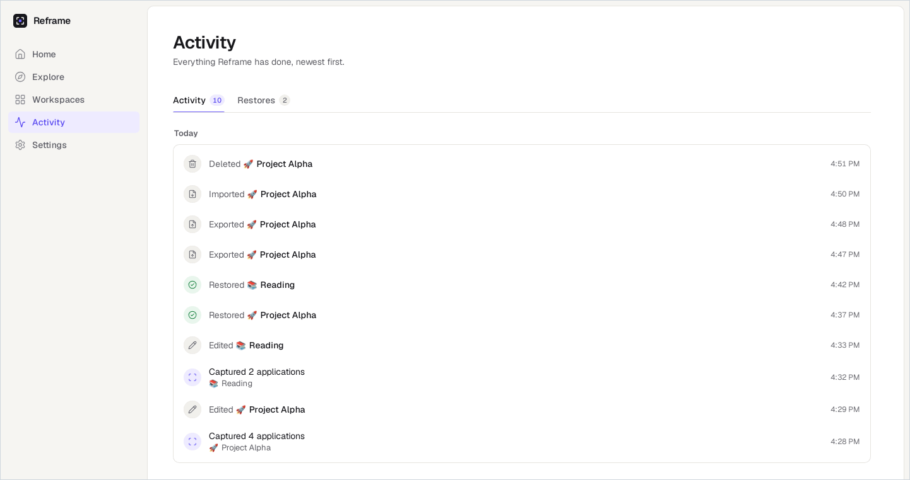

*The Activity tab, grouped by day. In this example an imported copy of Project Alpha was deleted again.*

- The **Activity** tab lists your recent captures, edits, restores (including partial and failed
  ones), imports, exports and deletions. Click an entry to open its workspace.
- The **Restores** tab lists your 50 most recent restores with their apps, mode, duration and
  result. Click one to open its full report, the same page you saw while it ran.

Home shows the latest entries under **Recent activity** (**View all** opens this page), and each
workspace page lists its own **Recent restores**.

## 10. Settings

Click **Settings** in the sidebar, or press Ctrl+, (⌘, on a Mac). Every change is saved as soon
as you make it.

### Appearance

Choose a **Theme**: **System** follows your computer's light or dark appearance, **Light** and
**Dark** stay put. The small button at the bottom-right of the sidebar, next to the version
number, switches themes too.

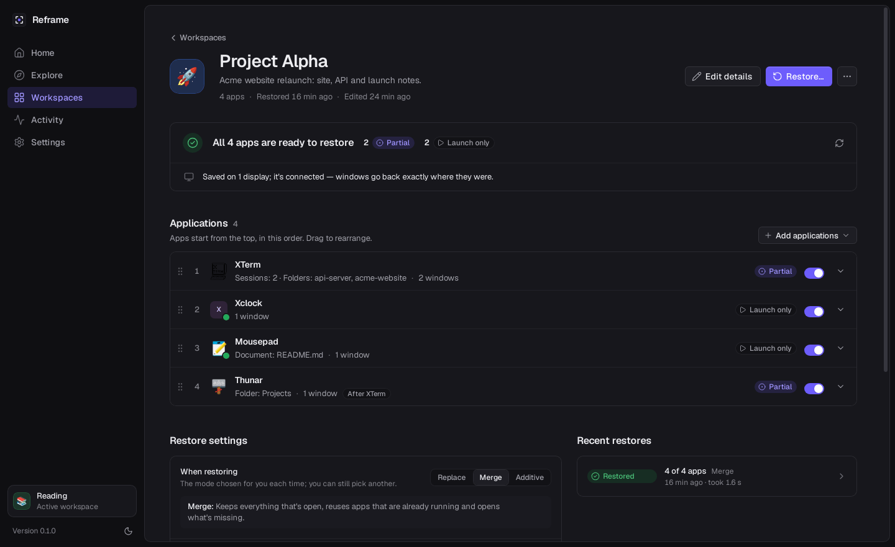

*Reframe in the dark theme.*

### Startup

See [section 6](#6-start-at-login-and-automatic-restore).

### Restoring, browser tabs and excluded apps

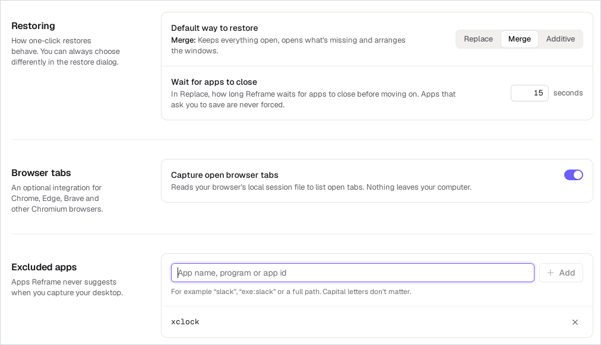

*How one-click restores behave, the browser tab integration and the apps Reframe never suggests.*

- **Default way to restore** is the mode that one-click **Restore** buttons use, and the one
  preselected when you choose **Restore with options…**. Restores from the tray menu and at
  login always use Merge.
- **Wait for apps to close** sets how long Replace waits for apps to close before moving on
  (1 to 120 seconds; 15 by default). Apps that ask you to save are never forced.
- **Capture open browser tabs** lets Reframe save the tabs of Chrome, Edge, Brave and Chromium
  (any channel, such as Beta or Canary) by reading the browser's own session file on your
  computer. Nothing leaves your computer. If you turn it off, Reframe saves only the browser's
  windows, and the browser may reopen its own last session. Other browsers, such as Firefox,
  Safari, Vivaldi or Opera, are restored as *Launch only* apps without their tabs.
- **Excluded apps** lists the apps Reframe never suggests. The easiest way to add one is
  **Always exclude** in Explore. You can also type the name of the app's program here (for
  example *slack*), or its full path, and click **Add**. Click **×** to remove one.

### Permissions (macOS)

On macOS this section shows whether **Accessibility** and **Screen recording** are granted, with
a **Grant** button for each one that isn't. Automation isn't listed here: macOS asks for it
separately for each app Reframe needs to control. To change it later, open
*System Settings → Privacy & Security → Automation*. Other systems don't need this section, so
it isn't shown there.

### This computer

This section shows honestly what Reframe can do on your system, and why when something is
limited.

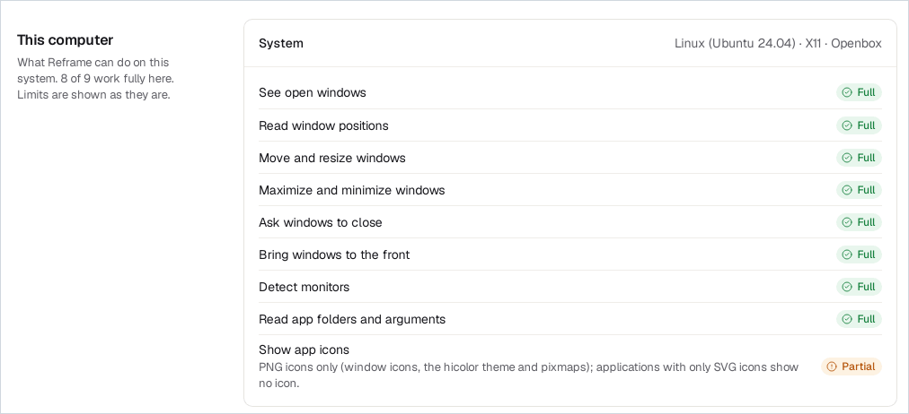

*On this Linux computer, 8 of 9 features work fully. The one marked Partial means some apps show their initials instead of their icon.*

### Keyboard shortcuts and About

| Shortcut | What it does |
|---|---|
| Ctrl+1 … Ctrl+5 (⌘1 … ⌘5) | Go to Home, Explore, Workspaces, Activity or Settings |
| Ctrl+, (⌘,) | Open Settings |
| Alt+← (⌘[ on a Mac) | Go back |
| Ctrl+S (⌘S) | Save changes to a workspace |
| Ctrl+F (⌘F) | Search on the Workspaces page |

**About** shows your Reframe version.

## What each app type restores

How much Reframe brings back depends on the app. The badge next to each app in Reframe always
tells you the level on your computer. In short:

| App type | What comes back | Limits |
|---|---|---|
| VS Code, VS Code Insiders, VSCodium | Project folders and `.code-workspace` files. The editor restores its own open files, terminals and unsaved changes. | Remote windows (SSH, WSL, containers) aren't reopened. Two projects with the same folder name, or a custom window title setting, can confuse it. Other editors, such as Cursor, are restored as *Launch only* apps. |
| Chrome, Edge, Brave, Chromium | Browser windows and their tabs (when **Capture open browser tabs** is on). | Pinned tabs come back as normal (unpinned) tabs. Tab groups and back/forward history aren't restored. Tabs opened in the last few seconds may be missing. One profile per app entry. Other browsers, such as Firefox, Safari, Vivaldi or Opera, are restored as *Launch only* apps without their tabs. |
| Terminals | Windows, working folders and profiles; startup commands only if you add and allow them. | Running programs, history and scrollback are never replayed. tmux, screen, zellij and SSH windows reopen in the terminal's default folder. Startup commands don't run in QTerminal, Deepin Terminal, Warp or terminals Reframe doesn't recognise, or in Terminal and iTerm2 when the folder name contains characters such as ' or ! (the folder still opens). On macOS each tab reopens as its own window. Terminals that show several windows from one program may not put each tab back in the same window. |
| File managers (Explorer, Finder, Nautilus, Dolphin, Thunar…) | Open folders. | Special places such as This PC or the Recycle Bin are skipped. On Linux, folder names in window titles must be unambiguous. On a Mac, saving Finder's folders needs the Automation permission. |
| PDF readers (SumatraPDF, Acrobat, Okular, Evince, Preview, zathura…) | Open documents, and the page where the reader supports it. | Readers mostly save the page when they close, so it can lag behind. On a Mac, saving what's open in Preview or Skim needs the Automation permission. |
| Music apps (Spotify, Apple Music…) | The app, and a playlist you choose (Spotify). | Playback position, queue and account aren't restored. |
| Any other app | The app, its window positions and states, and documents it was opened with. | What's inside the app comes back only if the app restores it itself. |

Windows go back to their saved size, position and display on Windows, on macOS (once you've
granted Accessibility) and on Linux with X11. Under a Linux Wayland session, only apps running
through XWayland are arranged; others are reopened without positioning. For the full technical
details, see [PLATFORM_SUPPORT.md](PLATFORM_SUPPORT.md).

## Tips for great workspaces

- **One workspace per context.** *Project Alpha*, *Reading* and *Meetings* restore faster and
  more predictably than one huge workspace.
- **Arrange first, then capture.** Put your windows where you like them before you save. That's
  exactly where they'll come back.
- **Check the readiness summary** on a new computer, or after installing or moving apps, before
  you rely on a workspace.
- **Use "start after" for real dependencies,** such as an editor that needs a running server.
  Leave everything else in list order so it can start in parallel.
- **Give slow apps time.** If an app takes a while to show its window, raise
  **Wait for its windows** for that app instead of slowing down the whole workspace.
- **Keep startup commands short and your own.** Only allow commands you wrote yourself.
- **Turn apps off instead of deleting them** when you don't need them for a while.
- **Re-capture with Update from current desktop** when a project changes a lot.
- **Pick the right mode.** Merge after a restart, Replace when switching projects, Additive when
  you want extra copies.
- **Watch out for Launch only apps that are already open.** Merge and Replace reuse any open
  window of such an app, even if it shows a different file. Close the app first, or use
  Additive, to open the file saved in the workspace.

## Troubleshooting and FAQ

### A window didn't go back to its place

- Some apps open their window late. Open the app's settings, go to **Order & timing** and raise
  **Wait for its windows**.
- Check that **Restore window positions** is on, both in the workspace's restore settings and in
  the app's **Order & timing** tab.
- Your system may adjust sizes slightly (terminals grow in whole-character steps) or keep
  windows inside the screen.
- On macOS, Reframe needs **Accessibility** permission, and macOS has no true "maximize": a
  window that filled the screen is restored to fill it again.
- Reframe arranges windows on your current virtual desktop or Space only.
- Under a Linux Wayland session, only apps running through XWayland can be positioned. See
  [I use Linux with Wayland](#i-use-linux-with-wayland).

### The restore didn't open the file I saved

For **Launch only** apps (such as Mousepad), Merge and Replace reuse a window of the app that's
already open, even if it shows a different file. Close the app first, or restore with
**Additive**, to open the file saved in the workspace.

### I use Linux with Wayland

Wayland doesn't let apps see or move other apps' native Wayland windows. If your session runs
XWayland (most GNOME and KDE sessions do), Reframe still lists and arranges the apps that run
through XWayland, and Explore shows only those, with a note. Without XWayland, Explore says
*Reframe can't see app windows here*, and restores can't arrange any window.

Either way, Reframe can still start every app in a workspace and reopen the projects, tabs and
terminal folders saved with it (captured in an X11 session or through XWayland, or imported). To
add apps that Explore can't see, build a workspace by hand: click **New workspace** on Home, give
it a name and click **Create workspace**, then click **Choose an app…** for each app you want
(once the workspace has apps, **Choose an app…** is under **Add applications**). Apps you add
this way only start; they don't reopen projects, tabs or folders. For full capture and window
management, log in to an X11 (Xorg) session.

### macOS keeps asking for permissions, or window titles are missing

Click **Grant** in **Settings → Permissions** (or **Grant access** on the Explore page) for each
permission that isn't granted, then switch **Reframe** on under *Accessibility* and
*Screen Recording* in *System Settings → Privacy & Security*. Quit and reopen Reframe after
granting Screen Recording.

If Reframe is already switched on there but still says it needs access (this can happen after
you update Reframe), select Reframe in the list, remove it with the **–** button, quit and reopen
Reframe, then click **Grant** again.

To save what's open in Finder, Preview or Skim (or to restore Terminal/iTerm2 profiles and
startup commands), allow Reframe when macOS asks to control that app. If you declined, turn it on
in *System Settings → Privacy & Security → Automation*.

### An app "can't be started on this computer"

The readiness summary at the top of the workspace page says when an app can't start, and why.
Typical reasons are *"… isn't installed at …"* (the app was moved, uninstalled or lives
somewhere else on this computer) and *"No executable is configured for …"* (Reframe couldn't
tell where the app's program is).

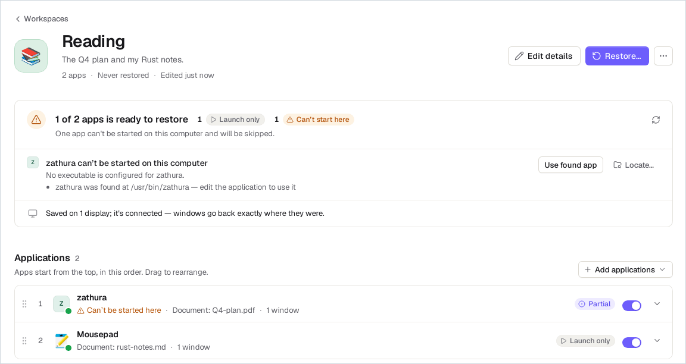

*Reframe found the app elsewhere, so **Use found app** fixes it in one click.*

- If Reframe found the app elsewhere, click **Use found app**.
- Otherwise click **Locate…** and pick the app's program yourself.

Apps that can't start show as **Failed** when you restore; fix them, then use **Retry failed**.
Everything else still comes back.

### Browser tabs are missing

- Check that **Settings → Capture open browser tabs** is on.
- Tabs are saved for Chrome, Edge, Brave and Chromium only. Other browsers are restored as
  *Launch only* apps.
- Browsers save their open tabs a few seconds after a change, so wait a moment after opening a
  tab before you save the workspace.
- Some newer browser versions encrypt their saved session. Reframe can't read those tabs, so it
  saves only the browser's windows and says so when you save.
- Pinned tabs come back as normal (unpinned) tabs. Tab groups and back/forward history aren't
  restored.
- Each app entry covers one browser profile.
- On Windows, a running browser can keep its current session file locked. Reframe then saves
  only the browser's windows and says so, instead of using older tabs.

### An app runs as administrator on Windows

Windows doesn't let normal apps move or close windows of apps running as administrator. Reframe
reports this instead of failing silently. Run that app normally, or run Reframe as
administrator too.

### An app asked me to save when I switched

That's expected: Replace asks apps to close normally, so an app with unsaved work asks you what
to do. Reframe shows it as **Still open** and waits up to **Wait for apps to close**, then
carries on with the rest. Save or discard your work in the app, and it closes.

### Will Reframe ever force-close my apps?

No. Closing is always a normal close request, like clicking the app's close button, and only
for the windows you confirmed in Replace mode. Apps can ask you to save, and windows that stay
open are reported, never killed.

### The Restore button is greyed out

The workspace has no apps switched on. Turn at least one app on, or add one (see
[Add and remove apps](#add-and-remove-apps)).

### A restore says "Interrupted"

Reframe was closed before the restore finished. Apps that opened are still open. Click
**Restore again** to run the restore again with the same mode. In Merge and Replace, apps that
already opened are reused (nothing is closed); in Additive, every app opens again.

### Where is my data stored?

Reframe keeps your workspaces, settings and history in a database, `reframe.db`, in its data
folder:

| System | Folder |
|---|---|
| Windows | `%APPDATA%\app.reframe.desktop` |
| macOS | `~/Library/Application Support/app.reframe.desktop` |
| Linux | `~/.local/share/app.reframe.desktop` |

To open the folder: on Windows, paste the path into the File Explorer address bar and press
Enter. On macOS, in Finder choose **Go → Go to Folder…** and paste the path. On Linux, open your
home folder and press Ctrl+H to show hidden folders, then open *.local*, *share* and
*app.reframe.desktop*.

While Reframe runs you'll also see `reframe.db-wal` and `reframe.db-shm` next to `reframe.db`.
Recent changes can be in those files, so to back up, quit Reframe and copy the whole folder.

Uninstalling Reframe keeps this folder (unless, on Windows, you tick
**Delete the application data** in the uninstaller), so your workspaces are still there if you
reinstall.

### How do I start fresh?

1. In **Settings → Startup**, turn off **Open Reframe when you log in**.
2. Quit Reframe.
3. Delete the folder listed in [Where is my data stored?](#where-is-my-data-stored).

The next time you open Reframe, it starts with no workspaces.

### Does Reframe need the internet?

No. Reframe makes no network connections, has no account and sends no data anywhere.

## Privacy and safety

- **Offline and private.** No account, and Reframe doesn't collect any data about you.
  Everything lives in Reframe's [data folder](#where-is-my-data-stored) on your computer.
- **Nothing is force-quit.** Reframe only asks apps to close, and only the ones you confirm.
- **No replaying of history.** Reframe never records or replays commands you typed. It runs a
  terminal startup command only if you added it and allowed it, and changing the command
  switches it off again.
- **Careful exports.** Passwords, tokens and secret links that Reframe recognises are removed
  from exported files, and startup commands are switched off. Check the file before you share
  it.
- **Strict imports.** Imported files are validated, startup commands arrive switched off and
  custom launch arguments are removed.
- **Honest limits.** When your system doesn't allow something, Reframe tells you so instead of
  pretending.
